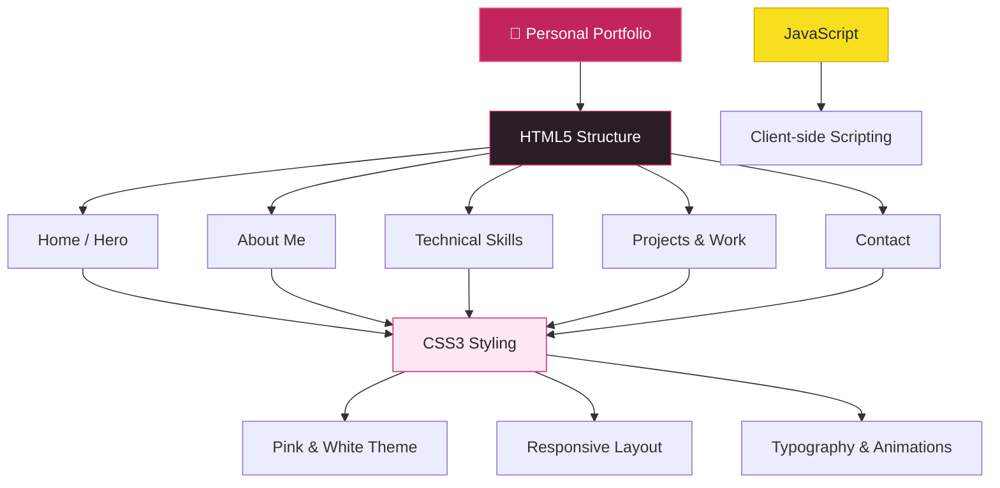

# 🌸 Sanhita's Portfolio
### Personal Portfolio Website | HTML • CSS • JavaScript

<p align="center">
  
</p>

<p align="center">
  <strong>Code with Creativity. Build with Passion. Grow with Technology.</strong>
</p>

<p align="center">
  A personal portfolio website showcasing my introduction, technical skills, projects, interests, and professional connections through a clean and responsive web experience.
</p>

<p align="center">
  <a href="https://github.com/Sanhita2006">
    
  </a>
  <a href="https://www.linkedin.com/in/sanhita-bhattacharjee-896283397">
    
  </a>
</p>

---

## 📌 Table of Contents

- [Overview](#-overview)
- [About Me](#-about-me)
- [Website Features](#-website-features)
- [Website Sections](#-website-sections)
- [Technology Stack](#-technology-stack)
- [Design & User Experience](#-design--user-experience)
- [Project Architecture](#-project-architecture)
- [Project Structure](#-project-structure)
- [Getting Started](#-getting-started)
- [Future Enhancements](#-future-enhancements)
- [License](#-license)
- [Connect With Me](#-connect-with-me)

---

## 🚀 Overview

**Sanhita's Portfolio** is a personal portfolio website developed to establish an online professional presence and showcase my journey as a Computer Science and Engineering undergraduate student.

The website highlights my technical interests, programming skills, educational background, and professional connections.

Designed with a clean pink-and-white aesthetic, the portfolio provides a simple and organized browsing experience through dedicated sections for introduction, about me, technical skills, projects, and contact information.

### 🎯 Project Goals

- Create a professional digital identity.
- Showcase my technical skills and interests.
- Present my journey in Computer Science & Engineering.
- Highlight my interests in Web Development and Cybersecurity.
- Provide easy access to my GitHub and LinkedIn profiles.
- Build a foundation for showcasing future projects.

---

## 👩‍💻 About Me

Hello! I'm **Sanhita Bhattacharjee**, a Computer Science & Engineering undergraduate student passionate about technology, Web Development, and Cybersecurity.

I enjoy exploring how web applications are developed and how they can be made more secure against modern vulnerabilities.

I'm continuously learning new technologies, improving my programming skills, and building practical projects to strengthen my technical knowledge.

**Areas of Interest:**

- 🌐 Web Development
- 🛡️ Cybersecurity
- 💻 Programming
- 🔐 Web Application Security
- 🚀 Software Development
- 🧩 Problem Solving

---

## ✨ Website Features

| Feature | Description |
|---|---|
| 🏠 Hero Section | Personal introduction and professional tagline |
| 🌷 About Me | Educational background and interests |
| 🛠️ Technical Skills | Programming and web development skills |
| 🚀 Projects & Work | Access to my GitHub projects |
| 📬 Contact Section | Email, LinkedIn, and GitHub connections |
| 📱 Responsive Layout | Adapts the layout for smaller screens |
| 🎨 Modern UI | Clean pink-and-white visual design |
| 🧭 Navigation | Quick links to different website sections |

---

## 🧩 Website Sections

### 01. 🏠 Home / Hero Section

The main introduction section of the portfolio.

- Welcome message.
- Personal introduction.
- CSE Undergraduate identity.
- Cybersecurity Enthusiast and Web Developer tagline.
- GitHub profile link.
- LinkedIn profile link.
- Email contact button.

### 02. 🌸 About Me

A dedicated section introducing my background and professional interests.

- Computer Science & Engineering student.
- Interest in Cybersecurity.
- Passion for Web Development.
- Focus on learning and building practical solutions.

### 03. 🛠️ Technical Skills

A visual presentation of my programming and web development skills.

| Skill | Category |
|---|---|
| C Language | Programming |
| Python | Programming |
| HTML5 | Web Development |
| CSS3 | Web Development |
| JavaScript | Web Development |

### 04. 🚀 Projects & Work

A dedicated section connecting visitors to my development work.

- GitHub profile integration.
- Explore project repositories.
- Access to my development journey.

### 05. 📬 Contact Section

A simple way to connect with me professionally.

- Email contact.
- LinkedIn profile.
- GitHub profile.

---

## 🛠️ Technology Stack

<p align="center">
  
  
  
  
  
</p>

| Technology | Purpose |
|---|---|
| HTML5 | Website structure and content |
| CSS3 | Styling, layout, and responsive design |
| JavaScript | Client-side scripting |
| Google Fonts | Typography |
| Font Awesome | Icons and visual elements |
| Git | Version control |
| GitHub | Source code hosting |

---

## 🎨 Design & User Experience

The portfolio uses a minimal and elegant design approach.

**Design highlights:**

- Pink and white color palette.
- Deep pink accent colors.
- Poppins typography.
- Clean navigation header.
- Modern card-based layout.
- Smooth scrolling.
- CSS hover transitions.
- Responsive grid layouts.
- Mobile-specific styling.

### 🎨 Color Palette

| Color | Hex Code | Usage |
|---|---|---|
| Deep Pink | `#DB2777` | Primary accent |
| Dark Pink | `#BE185D` | Hover effects |
| Soft Pink | `#FCE7F3` | Light backgrounds |
| Light Background | `#FFF5F7` | Main page background |
| White | `#FFFFFF` | Cards and surfaces |
| Dark Gray | `#27272A` | Main text |

---

## 🏗️ Project Architecture

The website follows a simple static frontend architecture.



---

## 📂 Project Structure

```text
portfolio/
│
├── index.html       # Main portfolio webpage
│
├── style.css        # Stylesheet
│
├── script.js        # JavaScript file
│
├── README.md        # Project documentation
│
├── LICENSE          # MIT License
│
└── .gitignore       # Git ignored files
```

---

## ⚙️ Getting Started

Follow these steps to run the project locally.

### Prerequisites

- A modern web browser.
- Git (optional).
- Visual Studio Code (recommended).

### Step 1: Clone the Repository

```bash
git clone https://github.com/Sanhita2006/portfolio.git
```

### Step 2: Navigate to the Project Directory

```bash
cd portfolio
```

### Step 3: Open the Project in VS Code

```bash
code .
```

### Step 4: Run the Website

Open `index.html` directly in your browser.

Alternatively, install the **Live Server** extension in Visual Studio Code.

Right-click `index.html` and select:

```text
Open with Live Server
```

The website will open in your default browser.

---

## 🔮 Future Enhancements

I plan to continuously improve this portfolio as I learn and build more projects.

- [ ] Add dedicated project showcase cards.
- [ ] Include live project demonstrations.
- [ ] Add downloadable resume.
- [ ] Include certifications and achievements.
- [ ] Add education and learning timeline.
- [ ] Introduce a dedicated Cybersecurity projects section.
- [ ] Improve animations and interactive elements.
- [ ] Enhance accessibility.
- [ ] Add a dedicated project details page.
- [ ] Continuously update technical skills and experience.

---

## 📜 License

This project is licensed under the **MIT License**.

See the [LICENSE](./LICENSE) file for details.

---

## 📬 Connect With Me

I'm always interested in learning, collaborating, exploring new technologies, and connecting with fellow developers.

<p align="center">
  <a href="mailto:sanghitab2006@gmail.com">
    
  </a>
  <a href="https://github.com/Sanhita2006">
    
  </a>
  <a href="https://www.linkedin.com/in/sanhita-bhattacharjee-896283397">
    
  </a>
</p>

---

<p align="center">
  <strong>🌸 Designed & Developed by Sanhita Bhattacharjee</strong>
</p>

<p align="center">
  <i>Code with Creativity. Learn with Curiosity. Build with Purpose.</i>
</p>

<p align="center">
  
</p>
